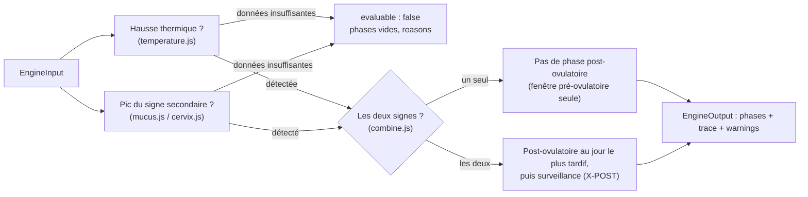

<p align="center">
  
</p>

# boussole-engine : moteur de calcul basé sur l'étude des symptômes

Moteur de calcul pour une méthode basée sur l'étude des symptômes, à **double vérification** : température + glaire cervicale (ou col de l'utérus). Fonctions pures, zéro dépendance, JavaScript ESM. À partir des observations journalières, il calcule les phases fertiles et infertiles du cycle, et expose le raisonnement complet qui mène au verdict (`ruleId`, trace, relevé jour par jour).

Ce moteur fait tourner l'application iOS **[Boussole](https://boussolecycle.com/)**. Ce dépôt sert à la transparence : chacun peut vérifier comment un verdict est calculé.

> ⚠️ **Ce logiciel n'est pas un avis médical.** Cette méthode ne s'apprend pas dans du code : elle s'apprend auprès d'une conseillère qualifiée, avec un thermomètre fiable. Ici, c'est un outil d'audit de calcul, pas un enseignement.

## Dépôt miroir en différé

Ce dépôt est un **miroir en différé** du dépôt de développement, privé. Il avance par snapshots volontaires, avec quelques semaines à quelques mois de retard sur le code livré dans l'app. Chaque snapshot est un tag. Les numéros d'issues cités dans les commentaires renvoient au backlog interne de développement.

## Comprendre le calcul

| Document | Rôle |
|----------|------|
| [`SPEC.md`](SPEC.md) | Spécification mécanique de la méthode : seuils, fenêtres, règles, dans l'ordre du calcul. |
| [`RULES.md`](RULES.md) | Traçabilité : chaque `ruleId` vers sa fonction et sa fixture de test. |
| [`docs/architecture.md`](docs/architecture.md) | Architecture : pipeline d'une évaluation, carte des modules, invariants. |
| [`docs/contrat-moteur.md`](docs/contrat-moteur.md) | Contrat d'interface : entrée/sortie (`EngineInput` → `EngineOutput`), codes `reason`/`warning`. |

Chaque fonction porte une annotation `@ruleRef <ID>` qui la relie à sa règle. Chaque règle a sa fixture golden dans `test/golden/fixtures/`.

## Architecture en bref

Un point d'entrée (`evaluate`), des fonctions pures, un verdict fail-safe : les deux signes doivent être détectés pour ouvrir la phase post-ovulatoire. Toute donnée manquante mène à `evaluable : false`, jamais à une devinette.



Le schéma détaillé, étape par étape : [`docs/architecture.md`](docs/architecture.md).

## Utilisation

```js
import { evaluate } from '@boussole/engine';
const output = evaluate(input); // EngineInput → EngineOutput (lève InputError si l'entrée est mal formée)
```

Le contrat complet d'entrée/sortie : [`docs/contrat-moteur.md`](docs/contrat-moteur.md).

```bash
npm ci
npm test      # golden + properties (fast-check) + différentiel
```

## Principes

- **Fail-safe** : moins de données ne donne jamais plus de jours infertiles. L'incertitude retire de la confiance, elle n'en ajoute pas.
- **Déterminisme** : pas d'horloge, pas d'entrées/sorties, pas d'aléatoire. « Aujourd'hui » est injecté par l'appelant.
- **Zéro dépendance** à l'exécution (les dépendances de dev ne servent qu'aux tests).
- **Clean-room** : le moteur a été écrit à partir de la spécification de la méthode, sans lire ni reprendre le code d'une autre implémentation.

## Licence et contributions

Code sous **AGPL-3.0-or-later**, voir [`LICENSE`](LICENSE).

Issues et pull requests bienvenues aux mêmes termes : en soumettant du code, vous l'acceptez sous AGPL-3.0-or-later. Pour une contribution substantielle, un accord de double licence avec l'auteur (qui garde une app propriétaire autour du moteur) peut être demandé ; nous vous contacterons alors.
