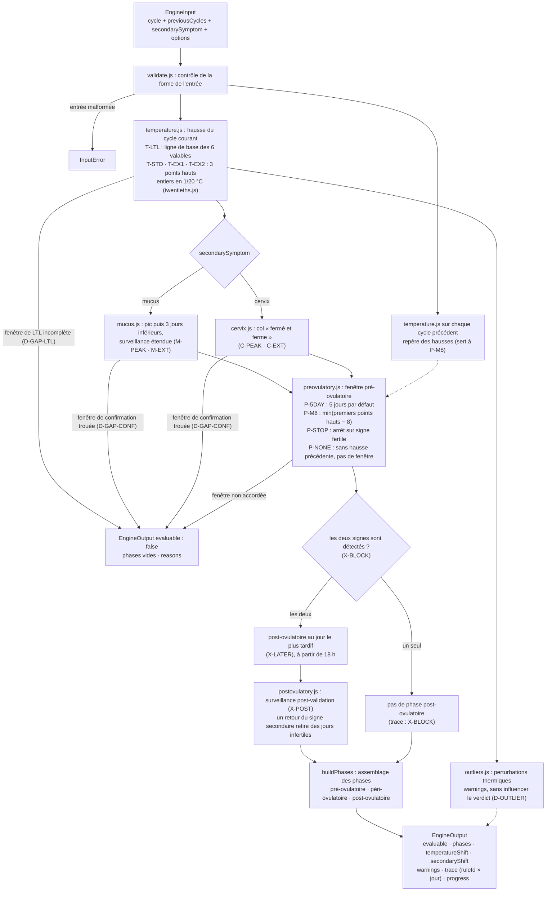

# Architecture du moteur

Le moteur est un package **sans dépendance**, fait de **fonctions pures** : pas d'horloge, pas d'I/O, pas d'état global. « Aujourd'hui » est injecté par l'appelant ; le même `EngineInput` produit toujours le même `EngineOutput`.

Il y a **un seul point d'entrée** : `evaluate()` (`src/evaluate.js`), qui orchestre des modules spécialisés, un par étape du calcul. Le pipeline ci-dessous suit l'ordre réel du code.

## Pipeline d'une évaluation

## Étape par étape

1. **Validation** (`validate.js`) : la forme de l'entrée est contrôlée ; toute malformation lève une `InputError` (`errors.js`), pas un verdict.
2. **Hausse thermique** (`temperature.js`, `twentieths.js`, `gaps.js`) : le calcul se fait en **vingtièmes de degré** (entiers, pas de flottants). La ligne de base (LTL) est le max des 6 relevés valables de la fenêtre (9 jours par défaut) ; la hausse exige 3 relevés au-dessus de la LTL, dont le 3ᵉ avec +0,20 °C, avec deux exceptions (T-EX1, T-EX2). Les relevés `excluded` comptent comme absents (D-EXCL).
3. **Perturbations** (`outliers.js`) : une température isolée vers le haut en phase basse produit un `warning`, sans changer le verdict (D-OUTLIER).
4. **Court-circuit fail-safe** : si la fenêtre de LTL ou la fenêtre de confirmation du pic est trouée, la sortie est `evaluable : false` avec des `reasons`, jamais une devinette.
5. **Signe secondaire** (`mucus.js` ou `cervix.js` selon `secondarySymptom`) : pic de glaire (dernier jour de la meilleure qualité) ou col « fermé et ferme », puis 3 jours inférieurs, puis surveillance étendue jusqu'à la fin d'évaluation de la température.
6. **Fenêtre pré-ovulatoire** (`preovulatory.js`) : 5 jours par défaut, raccourcie par P-M8 (`min(premiers points hauts − 8, 5)`) et par le premier jour sans signe secondaire observable ; pas de fenêtre si le cycle précédent n'a pas de hausse confirmée.
7. **Combinaison** (`combine.js`) : la phase post-ovulatoire n'existe que si **les deux** signes sont détectés (X-BLOCK) ; elle commence au jour **le plus tardif** des deux (X-LATER), à 18 h.
8. **Surveillance post-validation** (`postovulatory.js`) : règle propre à Boussole (empirique, plus prudente que la méthode de référence). Le signe secondaire reste lu jusqu'à la fin du cycle ; un retour de signe ne fait que **retirer** des jours infertiles (X-POST).
9. **Assemblage** : `buildPhases` produit les trois phases ; la trace agrège chaque `ruleId` émis jour par jour (voir `RULES.md`).

## Carte des modules

| Fichier | Rôle | Règles principales |
|---------|------|--------------------|
| `index.js` | API publique : `evaluate`, `InputError`, utilitaires de dates, fabrique de fixtures | aucune |
| `evaluate.js` | Orchestrateur : pipeline, court-circuits, assemblage des phases | aucune |
| `validate.js`, `errors.js` | Contrôle de la forme de l'entrée ; codes d'erreur | aucune |
| `temperature.js` | Détection de la hausse thermique | T-LTL, T-STD, T-EX1, T-EX2 |
| `twentieths.js` | Conversions °C / vingtièmes (entiers) | T-ROUND |
| `outliers.js` | Perturbations thermiques → warnings | D-OUTLIER |
| `mucus.js` | Pic de glaire + surveillance | M-PEAK, M-EXT |
| `cervix.js` | Variante col de l'utérus | C-PEAK, C-EXT |
| `gaps.js` | Données manquantes/exclues ; fenêtres exigées | D-EXCL, D-GAP-LTL, D-GAP-CONF |
| `preovulatory.js` | Fenêtre pré-ovulatoire | P-NONE, P-5DAY, P-M8, P-STOP |
| `postovulatory.js` | Surveillance post-validation | X-POST |
| `combine.js` | Les deux signes requis ; le plus tardif gagne | X-BLOCK, X-LATER |
| `progress.js` | Relevé d'avancement pour l'affichage (ne décide jamais ; aucune fonction ne relit ce qu'il produit) | aucune |
| `calendar.js` | Dates ISO ⇄ epoch days, arithmétique de dates | aucune |
| `cycles.js` | Détection des débuts de cycle | S-START |
| `materialize.js`, `cli.js` | Outils de test et CLI de développement (fixtures → `EngineInput`) | aucune |

## Invariants structurants

- **Fail-safe** (contrat §9) : moins de données, c'est **jamais plus de jours infertiles**. Toute incertitude supprime de la confiance, elle n'en ajoute jamais. C'est ce qui justifie les court-circuits `evaluable : false`.
- **Zéro flottant** : le moteur calcule en vingtièmes de degré entiers ; les °C n'apparaissent qu'aux frontières (entrée/sortie).
- **Traçabilité totale** : chaque étape émet ses `ruleId` dans la `trace` ; chaque `ruleId` a sa ligne dans `RULES.md` et sa fixture golden dans `test/golden/fixtures/`.
- **`progress.js` ne décide rien** : c'est un relevé « ce que voit le calcul », destiné à l'affichage de l'app hôte ; le moteur ne relit jamais ce qu'il produit.

Le contrat d'entrée/sortie complet (champs, codes `reason`/`warning`, invariants) : [`docs/contrat-moteur.md`](contrat-moteur.md). La spécification mécanique (seuils, fenêtres, règles) : [`SPEC.md`](../SPEC.md).
